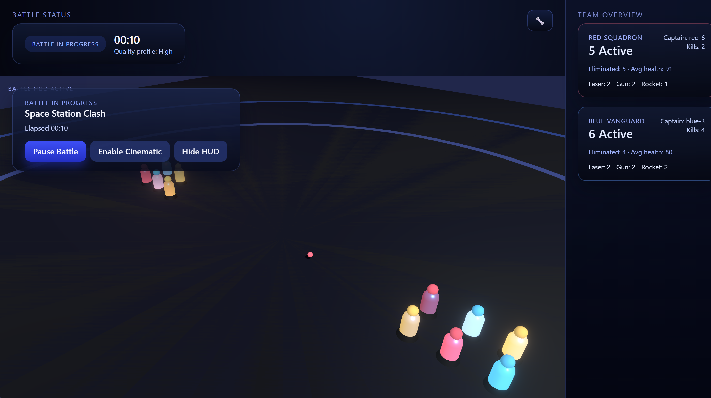

# Space Station Auto-Battler (Prototype)

A 3D team-vs-team auto-battler simulation built with React, TypeScript, and Three.js.



Live demo: https://deadronos.github.io/RobotSpaceBattler/

## Overview

This project simulates a battle between two teams of 10 humanoid robots (Red vs Blue) on a space station arena. It features:

- **Autonomous AI**: Robots use NavMesh pathfinding, behavior blending, and state machines for
  intelligent navigation and combat.
- **NavMesh Pathfinding**: Obstacle-aware navigation using A* search on polygon meshes with path
  smoothing and caching.
- **Behavior Blending**: Priority-based weighted blending of pathfinding, combat, and retreat
  behaviors for smooth concurrent AI.
- **Deterministic movement**: Fixed-step ECS simulation with 2D occlusion and obstacle tests, no physics engine.
- **ECS Architecture**: Uses `miniplex` for efficient entity management.
- **Visuals**: React Three Fiber renderer with shadows, lighting, and instanced visual effects.
- **Procedural Generation**: Arena and robot meshes are procedurally generated (placeholder visuals).

## Getting Started

### Prerequisites

- Node.js `^22.22.2`, `^24.15.0` or `^26.0.0` (see `package.json#engines`)
- npm

### Installation

1.  Clone the repository.
2.  Install dependencies:
    ```bash
    npm install
    ```

### Running the Simulation

Start the development server:

```bash
npm run dev
```

Open your browser to `http://localhost:5173`.

### Other Commands

- **Build**: `npm run build` - Builds the project for production and writes a bundle treemap to `dist/stats.html`.
- **Preview**: `npm run preview` - Serves the production build locally.
- **Lint**: `npm run lint` - Runs oxlint.
- **Lint (auto-fix)**: `npm run lint:fix`
- **Format**: `npm run format` - formats code with oxfmt.
- **Format check**: `npm run format:check`
- **Typecheck**: `npm run typecheck`
- **Test**: `npm run test` - Runs unit tests with Vitest.
- **Test (watch)**: `npm run test:watch`
- **Test (coverage)**: `npm run test:coverage`
- **E2E Test**: `npm run playwright:test` - Runs end-to-end tests.
- **E2E smoke via preview**: `npm run playwright:preview`
- **E2E smoke against a deployed site**: `SMOKE_BASE_URL=https://deadronos.github.io/RobotSpaceBattler/ npm run playwright:smoke:live` (without `SMOKE_BASE_URL` it builds and tests the local preview instead)

## Continuous Integration

`ci.yml` runs on every push to `main` and on all pull requests.

- Build/test matrix runs on Node 22, 24 and 26 and executes:
  - `npm run lint`
  - `npm run format:check`
  - `npm run typecheck`
  - `npm run test:coverage`
  - `npm run build`
- E2E smoke job runs Playwright against a production preview (`npm run playwright:preview`) on Node 24.
- The `CI` aggregate job fails if either matrix/e2e job fails.

### Release & deploy flow

- Merges to `main` run CI only.
- GitHub Pages deploy is tag-driven: creating a `v*` tag triggers `.github/workflows/publish-pages.yml`.
- After deploying, the `smoke-live` job runs the smoke spec against the published URL. To run it by hand, set `SMOKE_BASE_URL` (see above).

## Project Structure

The codebase is organized in `src/` as follows:

- **`components/`**: React components for the UI and 3D scene (React Three Fiber).
- **`ecs/`**: Entity Component System definitions (World, Systems, Entities).
- **`lib/`**: Utility libraries (Math, Random, Constants).
- **`runtime/`**: Simulation loop and state management logic.
- **`simulation/`**: Core game logic (AI, Pathing, Combat rules, Arena geometry).
- **`state/`**: Global application state (Zustand stores, Quality settings).
- **`visuals/`**: Visual managers (Instancing, Particle effects, Renderer stats).

## Key Technologies

- **React** + **TypeScript**: UI and logic.
- **React Three Fiber (@react-three/fiber)**: 3D rendering.
- **Miniplex**: ECS library.
- **Zustand**: State management.
- **Vitest**: Unit testing.
- **Playwright**: E2E testing.

## Pathfinding System

The NavMesh pathfinding system enables robots to navigate around obstacles intelligently:

### Features

- **A* Path Search**: Optimal path finding on polygon-based navigation meshes
- **Path Smoothing**: Funnel algorithm and path optimizer reduce waypoint count by ~40%
- **LRU Caching**: Frequently requested paths cached with 60s TTL (>70% hit rate)
- **Behavior Blending**: Concurrent AI execution with weighted blending (retreat > combat >
  pathfinding > idle)
- **Performance**: <5ms P95 path calculation, <16ms for 20 robots, <5MB memory

### Architecture

- `NavMeshGenerator` - Converts arena geometry to walkable polygons
- `AStarSearch` - Optimal path finding algorithm
- `PathOptimizer` & `StringPuller` - Path smoothing and simplification
- `PathfindingSystem` - ECS integration for per-robot path management
- `BehaviorBlender` - Priority-based weighted blending of AI behaviors

### Debug Visualization

Use `NavMeshDebugger` and `PathDebugger` components to visualize:

- NavMesh polygon structure (wireframe overlay)
- Active robot paths with waypoint markers
- Real-time path calculations

See `src/visuals/debug/` for implementation details.

## Documentation

This codebase is documented with JSDoc comments, so you can inspect any function, class or
interface in your IDE.

- [AGENTS.md](AGENTS.md): conventions and commands for contributors and coding agents
- [docs/agents/](docs/agents/): rules, architecture, tooling, testing, workflow, PRs
- [docs/README.md](docs/README.md): index of the other docs
- [scratch.md](scratch.md): current priorities
